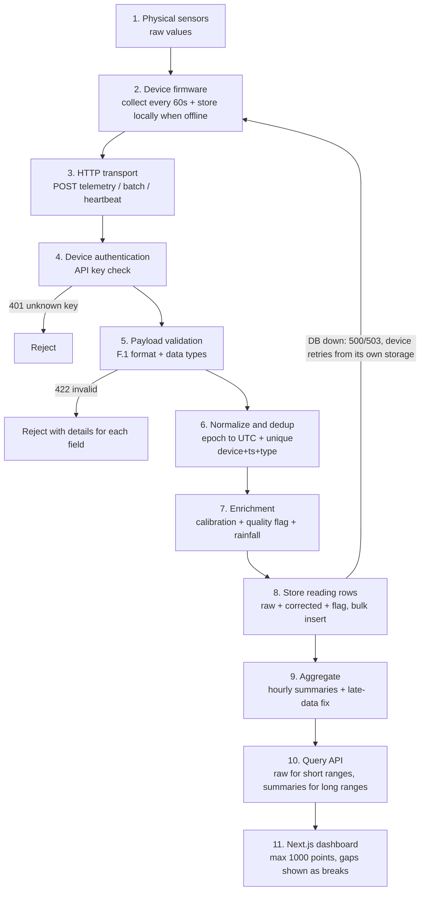

# Data Flow Diagram — Device to Chart (Part D)

> This file is the answer for Part D (BAGIAN D — Skema Alur Data) of the test. It holds the diagram plus a short explanation of each step.
> The detailed reasons behind design choices (for example why dedup uses a unique key, or why timestamps are stored in UTC) are written in `JAWABAN.md` part D, not here. README only links to this file.

## Step notes

1. **Sensors.** Seven physical sensors (air temperature, humidity, pressure, wind speed, wind direction, rain counter, solar radiation) take readings. Output is raw and not yet corrected. A broken sensor is simply left out of the report.
2. **Firmware.** Collects all sensors every 60 seconds and adds timestamp, sequence number, battery voltage, signal strength, and firmware version. When the internet is down, readings wait in the device memory until it is back online.
3. **Transport.** Firmware sends HTTP POST: single reports to `/ingest/telemetry`, waiting piles to `/ingest/telemetry/batch`, heartbeat reports with no sensor data to `/ingest/heartbeat`.
4. **Authentication.** The backend checks the API key against the hash stored for that `device_id`. Unknown key: 401. Retired device: rejected.
5. **Validation.** Structure is checked against the F.1 contract (required fields, types, readings list). Bad reports get 422 with details for each wrong field.
6. **Normalize and dedup.** Epoch seconds become UTC time. Repeat sends (device got no ACK) are thrown away using the unique key on `(device_id, ts, sensor_type)`.
7. **Enrichment.** Raw values are fixed with calibration `(raw + offset) * scale`. Every row gets a quality flag (good, out of range, sensor error, suspect time). Rain counter steps become millimetres (0.2 mm per tip, safe against restarts).
8. **Store reading rows.** Bulk insert in narrow shape (one row per sensor) into `sensor_readings`. Each row carries the original value (`raw`), the calibrated value (`corrected`), and the quality flag together. Old rows are never changed, only added.
9. **Aggregate.** Per-hour average, min, max, sum, and rainfall totals go to `reading_aggregates`. Late batches cause the hour groups they fall into to be counted again.
10. **Query API.** Short ranges (7 days or less) may read raw rows; long ranges must read summaries. At most 1000 points per answer. Devices log in with API keys, dashboards with user JWT.
11. **Dashboard.** Overview (one card per device, 30-second refresh), detail (temperature/humidity lines, rainfall bars, wind), management (tables plus forms). Times shown in WIB; missing data shows as a broken line, never as zero.

**If the database is down when a report arrives**, the backend answers 500/503 (never success), the device keeps the report in its own storage and tries again. No data goes missing without us knowing. More details about the queue are in `JAWABAN.md` part D.
